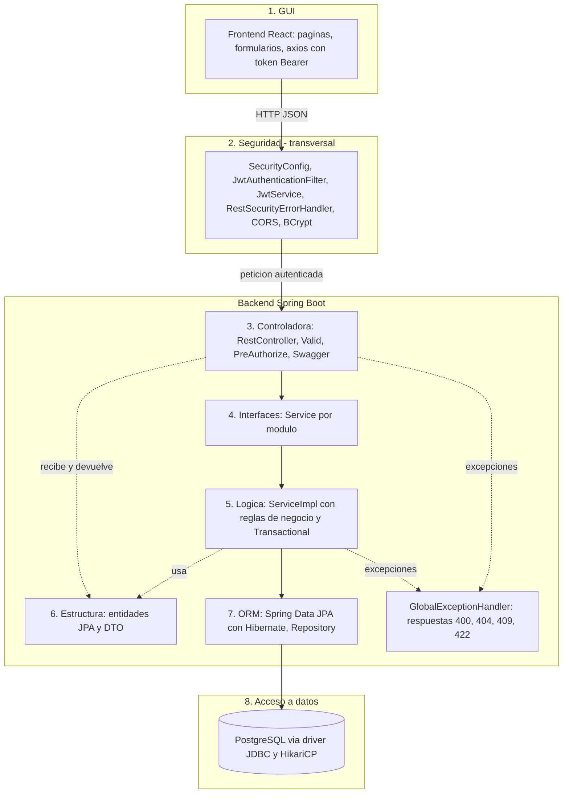
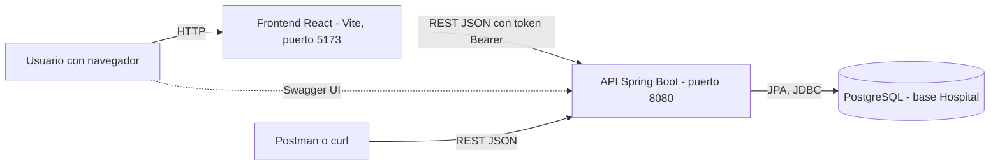
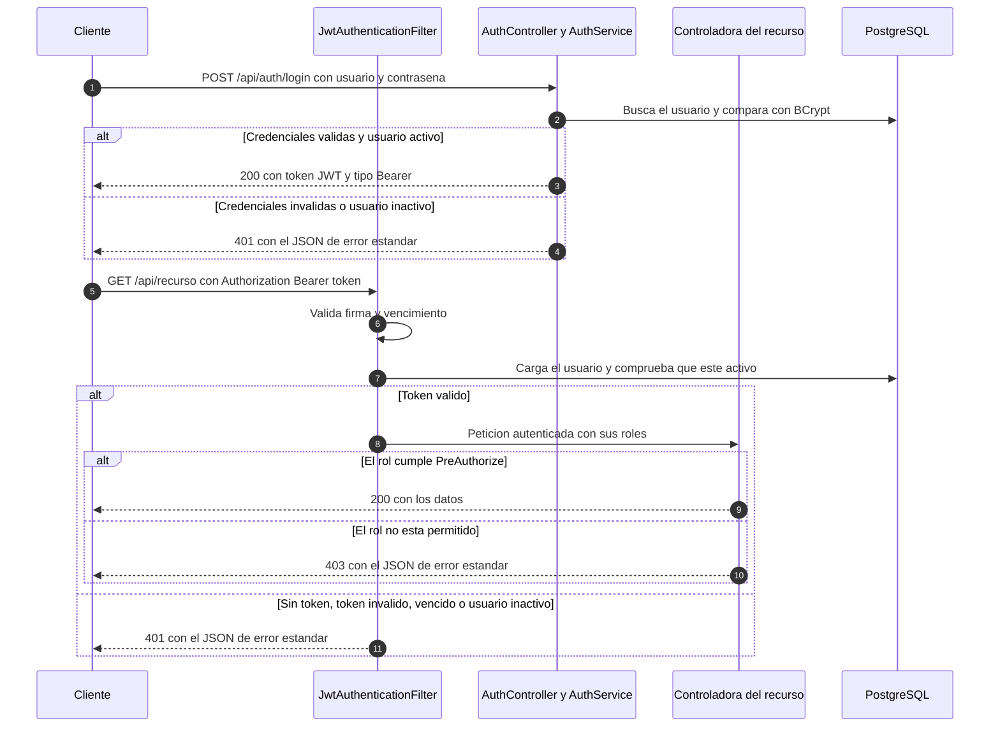
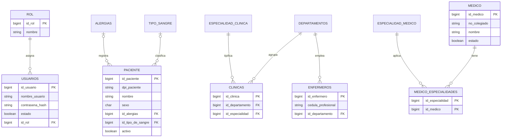
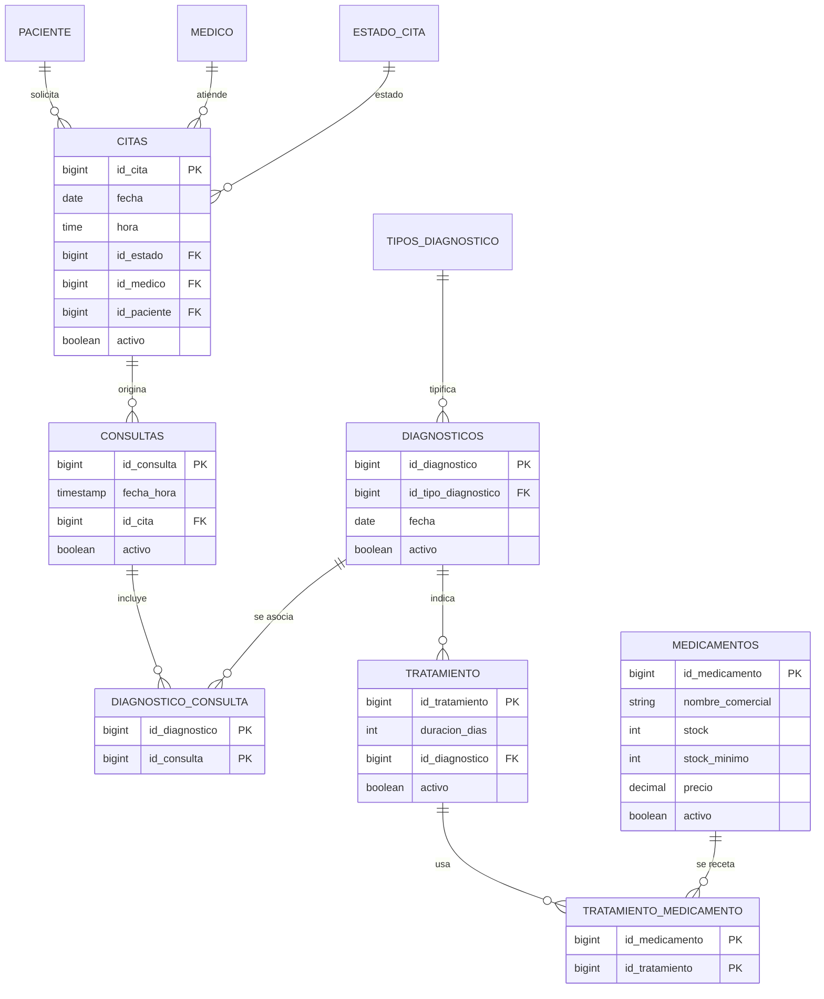
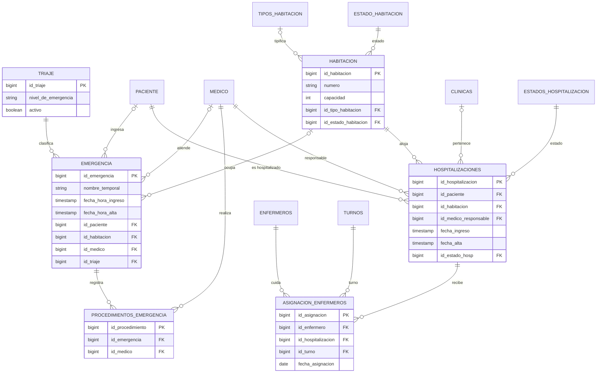
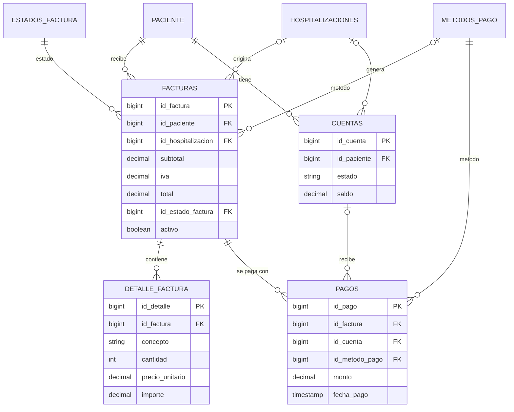

# Arquitectura del sistema

Documento de arquitectura del proyecto API Hospital (Arquitectura de Sistemas, UMES). Describe lo que está **implementado** en el repositorio; las diferencias respecto al diseño presentado en la entrega 1 están en la [sección 9](#9-diferencias-con-el-diseño-de-la-entrega-1).

Documentos relacionados: [README](../README.md), [API](api.md), [pruebas](pruebas.md).

## 1. Dominio y alcance

Sistema de gestión hospitalaria de un hospital privado en Guatemala ([COMPLETAR: nombre del hospital]). Cubre tres áreas asistenciales, apoyadas por farmacia y facturación:

- **Clínica (consulta externa):** citas, consultas, diagnósticos y tratamientos.
- **Emergencias:** ingreso con nivel de triaje, procedimientos y alta.
- **Hospitalización:** ingreso a habitación, asignación de enfermeros y alta.
- **Farmacia:** catálogo de medicamentos, stock y medicamentos de cada tratamiento.
- **Facturación:** facturas con líneas de detalle, cuentas y pagos.

Los 8 módulos de la rúbrica son Autenticación, Administración (estructura y personal), Pacientes, Clínica, Emergencias, Hospitalización, Farmacia y Facturación. Se añade un módulo transversal de Reportes (resumen para el inicio e historial del paciente).

**Actores (roles):** `ADMIN`, `MEDICO`, `ENFERMERO`, `RECEPCIONISTA`, `FARMACEUTICO` y `CAJERO`. Los pacientes no son usuarios del sistema.

**Particularidades de Guatemala:** DPI de 13 dígitos para identificar al paciente, moneda en quetzales (GTQ) e IVA de 12 % (configurable con `FACTURACION_IVA`).

**Fuera de alcance:** laboratorio e imágenes, quirófano, seguros y convenios, insumos no farmacéuticos, factura electrónica (FEL), portal de pacientes y telemedicina.

**Reglas de negocio principales implementadas** (cada una vive en el `ServiceImpl` de su módulo y tiene pruebas con mocks):

1. Un médico no puede tener dos citas activas en la misma fecha y hora (409); la fecha de una cita nueva no puede ser pasada.
2. Todo ingreso a emergencia exige un nivel de triaje activo; el paciente puede ser no identificado (nombre temporal).
3. Una hospitalización solo se registra si la habitación está activa, no está en mantenimiento y tiene cupo; el estado de la habitación debe ser coherente con su ocupación.
4. Un paciente no puede tener dos hospitalizaciones activas (409); el alta cierra la hospitalización y libera la habitación.
5. Un diagnóstico exige un tipo de diagnóstico activo; no se desactiva si está ligado a una consulta o tiene tratamientos.
6. El stock de un medicamento nunca queda negativo ni se ajusta si el medicamento está inactivo.
7. Total de factura = subtotal + IVA; el servidor calcula los importes a partir de las líneas. El pago no puede superar el saldo pendiente y el estado de la factura solo avanza con transiciones válidas.
8. Los registros con historial no se borran: se desactivan (borrado lógico), y no se desactivan si tienen dependientes activos.

## 2. Arquitectura en capas

El backend es un monolito Spring Boot organizado **por módulo de negocio**. Cada paquete de módulo (por ejemplo `citas`, `pagos`, `hospitalizaciones`) contiene sus propias capas, y el código transversal vive en `shared/`:

```
hospital/src/main/java/com/example/hospital/
  <modulo>/
    <Modulo>Controller.java      Controladora (REST)
    <Modulo>Service.java         Interfaz del servicio
    impl/<Modulo>ServiceImpl.java   Lógica de negocio
    <Modulo>Repository.java      Acceso a datos con Spring Data JPA
    <Modulo>.java                Entidad JPA
    dto/<Modulo>DTO.java         Objetos de entrada y salida con validaciones
  shared/
    config/      SecurityConfig, SwaggerConfig, DataInitializer
    security/    JwtService, JwtAuthenticationFilter, UsuarioDetailsService, RestSecurityErrorHandler
    exception/   GlobalExceptionHandler, ErrorResponse y excepciones de negocio
    catalogos/   EstadosCatalogo (resuelve estados por nombre)
    constants/   ApiConstants
```

### 2.1 Diagrama de capas



Swagger (springdoc) no es una capa: es documentación generada a partir de las anotaciones de la capa de controladoras.

### 2.2 Qué hace cada capa

| # | Capa | Dónde está | Qué hace | Qué no puede hacer | Con quién se comunica |
|---|---|---|---|---|---|
| 1 | **GUI** | `frontend/src` (React) | Pantallas, formularios, validación previa y menús según el rol. Guarda el token y lo envía en cada petición. | No contiene reglas de negocio ni accede a la base de datos; el backend es la fuente de verdad. | Solo con la API REST por HTTP (axios). |
| 2 | **Seguridad** (transversal) | `shared/security`, `shared/config/SecurityConfig` | Autentica con JWT, carga el usuario, rechaza tokens inválidos o de usuarios inactivos (401), aplica CORS, cifra contraseñas con BCrypt y devuelve 401 y 403 en JSON. | No decide reglas de negocio ni toca datos de dominio. | Con el filtro de Spring Security antes de las controladoras y con el repositorio de usuarios. |
| 3 | **Controladora** | `<modulo>/*Controller.java` | Expone los endpoints, valida el cuerpo con `@Valid`, declara los roles con `@PreAuthorize` y documenta con `@Operation`. Traduce el resultado a HTTP (200, 201, 204). | No contiene lógica de negocio ni usa repositorios o entidades directamente. | Con la interfaz del servicio y con los DTO. |
| 4 | **Interfaces** | `<modulo>/*Service.java` | Define el contrato de cada caso de uso. Permite sustituir la implementación y hacer mocks en las pruebas. | No tiene código. | Las usa la controladora; las implementa la capa de lógica. |
| 5 | **Lógica** | `<modulo>/impl/*ServiceImpl.java` | Aplica las reglas de negocio, controla transacciones (`@Transactional`) y decide qué excepción lanzar (404, 409, 422). Convierte entidades en DTO. | No conoce HTTP, ni la seguridad, ni SQL. | Con los repositorios (propios y de otros módulos), `EstadosCatalogo` y `CalculoImportes`. |
| 6 | **Estructura** | `<modulo>/*.java` (entidades) y `<modulo>/dto` | Define los datos: entidades JPA mapeadas a las tablas y DTO (`record`) con Bean Validation para la entrada y salida. | No contiene comportamiento de negocio. | Las entidades las usan la lógica y el ORM; los DTO, la controladora y la lógica. |
| 7 | **ORM** | `<modulo>/*Repository.java` | Spring Data JPA con Hibernate: consultas derivadas por nombre de método, sin SQL escrito a mano. | No aplica reglas de negocio. | Con las entidades y con la capa de datos. |
| 8 | **Acceso a datos** | Driver JDBC de PostgreSQL y HikariCP | Abre las conexiones y ejecuta el SQL que genera Hibernate. | No conoce el dominio. | Con PostgreSQL. |

El manejo de excepciones (`GlobalExceptionHandler`, `@RestControllerAdvice`) completa el flujo de errores: convierte las excepciones de negocio en la respuesta JSON estándar.

### 2.3 Flujo de una petición (ejemplo: registrar un pago)

1. El navegador envía `POST /api/pagos` con `Authorization: Bearer <JWT>`.
2. `JwtAuthenticationFilter` valida el token, comprueba que el usuario esté activo y carga sus roles.
3. `PagosController` valida el cuerpo (`@Valid`) y `@PreAuthorize` comprueba el rol (ADMIN o CAJERO).
4. `PagosServiceImpl` verifica que la factura esté Pendiente y que el monto no supere el saldo; si algo falla lanza una excepción y no guarda nada.
5. El repositorio guarda el pago y el servicio actualiza el estado de la factura dentro de la misma transacción.
6. La controladora responde `201` con el DTO del pago, o `GlobalExceptionHandler` responde con el error en JSON.

## 3. Componentes y despliegue



| Componente | Tecnología | Puerto por defecto |
|---|---|---|
| Frontend | Vite, React 19, React Router 7, axios, Bootstrap 4.6 y reactstrap 9 (tema Now UI Dashboard) | 5173 |
| Backend | Spring Boot 4.1.1, Java 21, Spring Security, Spring Data JPA, springdoc-openapi 3.1.0, jjwt 0.12.6 | 8080 |
| Base de datos | PostgreSQL, esquema `hospital/Hosp_postgres.sql` (38 tablas) | 5432 |

En desarrollo cada pieza corre en su puerto y el backend permite el origen del frontend por CORS (`CORS_ORIGINS`). Para publicarlo en la web: [COMPLETAR: URL de la API y del frontend, y si se despliega con HTTPS].

## 4. Autenticación JWT



Detalles de la implementación:

- El token es un JWT firmado con HS256 que lleva el usuario (`sub`) y sus roles (`roles`). Duración de 1 hora (`JWT_EXPIRATION_MS`, por defecto 3600000). No hay refresh token.
- El secreto sale de la variable `JWT_SECRET` (hay un valor por defecto solo para desarrollo que **debe cambiarse** en producción).
- Sesión `STATELESS` y CSRF desactivado (la API no usa cookies).
- Rutas públicas: `POST /api/auth/login` y la documentación (`/swagger-ui/**`, `/swagger-ui.html`, `/v3/api-docs/**`). Todo lo demás exige token (`anyRequest().authenticated()`).
- Los errores 401 y 403 de la capa de seguridad (`RestSecurityErrorHandler`) devuelven el mismo formato JSON que el resto de la API.
- El usuario administrador inicial lo crea `DataInitializer` al arrancar, con las credenciales de `ADMIN_USER` y `ADMIN_PASSWORD`. Los demás usuarios solo los crea un ADMIN (`POST /api/auth/register` o `POST /api/usuarios`).

## 5. Modelo de seguridad

La autorización se declara con `@PreAuthorize` en cada método de las controladoras (`@EnableMethodSecurity`). Muchas lecturas de catálogos no tienen `@PreAuthorize` y las puede consultar cualquier usuario autenticado. Resumen por recurso, generado a partir de los 219 endpoints reales:

- **E**: puede ejecutar todas las operaciones de escritura (POST, PUT, PATCH y DELETE) del recurso.
- **E\***: puede ejecutar solo algunas operaciones de escritura (por ejemplo crear pero no desactivar).
- **L**: solo lectura (todos los GET del recurso).
- **L\***: puede leer solo parte de los GET del recurso.
- **-**: sin acceso (403).

| Recurso | ADMIN | MEDICO | ENFERMERO | RECEPCIONISTA | FARMACEUTICO | CAJERO |
|---|---|---|---|---|---|---|
| **Autenticación y usuarios** | | | | | | |
| Autenticación | E | E* | E* | E* | E* | E* |
| Usuarios | E | - | - | - | - | - |
| Roles | E | - | - | - | - | - |
| **Administración** | | | | | | |
| Departamentos | E | L | L | L | L | L |
| Clínicas | E | L | L | L | L | L |
| Especialidad de clínica | E | L | L | L | L | L |
| Especialidades médicas | E | L | L | L | L | L |
| Médicos | E | L | L | L | - | - |
| Médico – especialidades | E | L | L | L | L | L |
| Enfermeros | E | L | L | L | L | L |
| Turnos | E | L | L | L | - | - |
| **Pacientes** | | | | | | |
| Pacientes | E | L* | L* | E* | - | L* |
| Alergias | E | E* | L | L | - | - |
| Tipos de sangre | E | L | L | L | L | L |
| **Clínica (consulta externa)** | | | | | | |
| Citas | E | E* | L | E* | L | L |
| Estados de cita | E | L | L | L | L | L |
| Consultas | E | E* | L | L | L | L |
| Diagnósticos | E | E* | L | L | L | L |
| Tipos de diagnóstico | E | L | L | L | L | L |
| Diagnóstico por consulta | E | E | L | L | L | L |
| Tratamientos | E | E* | L | L | L | L |
| **Emergencias** | | | | | | |
| Emergencia | E | E* | E* | L | L | L |
| Triaje | E | E* | E* | L | - | - |
| Niveles de urgencia | E | L | L | L | - | - |
| Procedimientos de emergencia | E | E* | L | - | - | - |
| **Hospitalización** | | | | | | |
| Hospitalizaciones | E | E* | L* | E* | - | L* |
| Estados de hospitalización | E | L | L | L | L | L |
| Asignación de enfermeros | E | L | L | L | L | L |
| Habitaciones | E | L | L | L | - | - |
| Tipos de habitación | E | L | L | L | L | L |
| Estados de habitación | E | L | L | L | L | L |
| **Farmacia** | | | | | | |
| Medicamentos | E | E* | L | L | E* | L |
| Tratamiento – medicamentos | E | E | - | - | L | - |
| **Facturación** | | | | | | |
| Facturas | E | L* | L* | E* | L* | E* |
| Detalle de factura | E | L | L | E* | L | E* |
| Cuentas | E | L | L | L | L | E* |
| Pagos | E | - | - | - | - | E* |
| Estados de factura | E | L | L | L | L | L |
| Métodos de pago | E | - | - | L | - | L |
| **Reportes** | | | | | | |
| Reportes | L | L | L | L* | - | L* |

Observaciones:

- Los GET sin `@PreAuthorize` aparecen como **L** para todos los roles (catálogos, estados, etc.). En facturas, cuentas y detalle de factura la lectura general también está abierta a cualquier usuario autenticado; es una política de lectura pendiente de definir (ver [sección 8](#8-decisiones-de-diseño)).
- `DELETE` en la mayoría de los recursos es solo de ADMIN (desactivación lógica).
- El frontend replica esta tabla en `frontend/src/config/menu.js` para mostrar solo lo que cada rol puede usar, pero el backend es quien impone los permisos.

## 6. Manejo de errores

`GlobalExceptionHandler` traduce las excepciones al formato único:

```json
{
  "timestamp": "2026-01-15T10:30:00",
  "status": 404,
  "error": "Not Found",
  "message": "No existe el diagnóstico con ID: 5",
  "path": "/api/diagnosticos/5",
  "detalles": null
}
```

`detalles` solo aparece en los errores de validación y mapea campo a mensaje.

| Código | Excepción o causa | Ejemplo |
|---|---|---|
| 400 | `MethodArgumentNotValidException` (Bean Validation), `HttpMessageNotReadableException`, tipo de parámetro incorrecto, `IllegalArgumentException` | Falta un campo obligatorio, JSON mal formado, `id` no numérico. |
| 401 | `AuthenticationException` y entry point de seguridad | Token ausente, inválido o vencido; usuario inactivo. |
| 403 | `AccessDeniedException` | El rol no puede ejecutar la operación. |
| 404 | `RecursoNoEncontradoException` | El recurso de la URL no existe. |
| 409 | `DuplicadoException`, `IllegalStateException` | DPI repetido, par ya asignado, desactivar algo con dependientes activos. |
| 422 | `ReglaNegocioException` | Referencia inexistente o inactiva en el cuerpo, fechas incoherentes, stock insuficiente, transición no permitida. |
| 500 | `Exception` genérica | Error inesperado; el mensaje no expone detalles internos. |

Convención aplicada en los servicios: obligatoriedad, formato y tamaños se validan con Bean Validation en los DTO (400 con `detalles`); las reglas que dependen del estado del sistema se validan en el servicio (409 o 422); un id de la URL inexistente da 404 y un id inexistente dentro del cuerpo da 422.

## 7. Modelo de datos

El esquema está en `hospital/Hosp_postgres.sql`: **38 tablas** (16 catálogos y 22 tablas de negocio o enlace) con claves foráneas, restricciones `CHECK` e índices, más datos iniciales de los catálogos. Las entidades JPA se mapean a estas tablas; el esquema no se genera desde Hibernate. A continuación se muestran los diagramas por área, solo con los atributos principales.

### 7.1 Seguridad, pacientes y personal



### 7.2 Clínica



### 7.3 Emergencias y hospitalización



La tabla `niveles_urgencia` (códigos N1, N2, N3... con tiempo máximo de espera y color) es un catálogo independiente: no tiene claves foráneas, y el nivel de cada emergencia se guarda con la tabla `triaje`.

### 7.4 Facturación



Restricciones de la base que respaldan las reglas de negocio: `total = subtotal + iva`, `importe = cantidad * precio_unitario`, `stock >= 0`, `monto > 0`, `capacidad > 0`, fechas de alta no anteriores al ingreso y fecha de fin de tratamiento no anterior al inicio.

## 8. Decisiones de diseño

- **Monolito modular por paquetes de negocio**, con las capas dentro de cada módulo. Mantiene el código de un caso de uso junto y deja claro dónde está cada responsabilidad.
- **Interfaz + implementación por servicio:** permite probar la lógica con Mockito y cumple la capa de interfaces del diseño.
- **DTO como `record` con Bean Validation:** la controladora nunca expone entidades. La validación de formato da 400 con `detalles` por campo.
- **ORM sin SQL en crudo:** solo consultas derivadas de Spring Data JPA; no se usan `@Query` nativas.
- **Borrado lógico (`activo`):** conserva el historial clínico y contable; no se desactiva un registro con dependientes activos.
- **Estados por nombre:** `EstadosCatalogo` resuelve los estados base (hospitalización Activa o Alta, habitación Disponible, Ocupada o Mantenimiento, factura Pendiente, Pagada o Cancelada) con caché; los catálogos protegen esos valores base contra cambios.
- **El servidor calcula los importes de las facturas** (`CalculoImportes`, IVA configurable): el cliente no puede fijar subtotal, IVA ni total.
- **Seguridad con JWT sin estado:** sin sesiones, sin cookies y sin CSRF. Un token de un usuario desactivado deja de funcionar al instante porque el filtro consulta al usuario.
- **Permisos de lectura abiertos en catálogos:** cualquier usuario autenticado lee catálogos y estados; la escritura es restringida por rol.
- **Esquema SQL propio:** el esquema se crea con `Hosp_postgres.sql` y Hibernate no lo modifica; esto evita cambios accidentales en la base.
- **Pruebas unitarias con Mockito sobre servicios** (ver [pruebas.md](pruebas.md)); la prueba de integración con base de datos es opcional.

Pendientes conocidos:

- La lectura de facturas, líneas y cuentas está abierta a cualquier usuario autenticado (política por definir).
- No hay renovación del token: al vencer hay que iniciar sesión otra vez.
- No hay pruebas automáticas de la interfaz.
- No hay endpoint para dispensar recetas con descuento automático de stock: el stock se ajusta con `PATCH /api/medicamentos/{id}/stock`.

## 9. Diferencias con el diseño de la entrega 1

La entrega 1 fue un diseño previo a la implementación. Estas son las diferencias reales entre ese diseño y el código final:

| Tema | Diseño de la entrega 1 | Implementación final |
|---|---|---|
| Tablas | 39 tablas | 38 tablas. No existen `estados_emergencia`, `destinos_alta`, `horarios_medico`, `recetas` ni `paciente_alergia`; existen `triaje`, `cuentas` y `tratamiento_medicamento`. |
| Alergias del paciente | Relación muchos a muchos (`paciente_alergia`) | Una alergia opcional por paciente (`paciente.id_alergias`). |
| Horario del médico | Tabla `horarios_medico` y validación de la cita dentro del horario | No se implementó; solo se valida que el médico no tenga otra cita activa a la misma fecha y hora. |
| Recetas | Tabla `recetas` y `POST /api/recetas/{id}/dispensar` (descuenta stock) | Medicamentos por tratamiento (`/api/tratamiento-medicamento`) y ajuste manual de stock; no hay dispensación automática. |
| Emergencia y hospitalización | `hospitalizaciones.id_emergencia`; estados y destino de alta de emergencia en catálogos | No hay vínculo entre hospitalización y emergencia; la emergencia se cierra con `fecha_hora_alta`. |
| Endpoints | 84 endpoints | 219 endpoints (CRUD completo de catálogos y filtros adicionales). |
| Rutas | Prefijo `/api`; listas paginadas con `page` y `size` | `/api/...` y `/api/v1/paciente` para pacientes; listados sin paginación. |
| Duración del token | 2 horas (7200 s) | 1 hora (`JWT_EXPIRATION_MS`, 3600000). |
| Respuesta de login | `{ token, tipo, expiraEn, rol }` | `{ token, type }`; el rol se consulta con `GET /api/auth/me`. |
| Roles | Roles en la tabla `roles_usuario` | Tabla `rol`; los 6 roles los crea `DataInitializer` al arrancar. |
| Propiedad de la consulta | Un médico solo modifica sus propias consultas | No se implementó: el permiso es por rol. |
| Configuración JPA | `ddl-auto=validate` y `open-in-view=false` | No se fijan esas propiedades; el esquema se crea a mano con el script SQL. |
| Cuentas | No contempladas | Módulo de cuentas del paciente (`/api/cuentas`) enlazado a los pagos. |
| Registro de usuarios | `POST /api/auth/register` | Igual, y además CRUD de usuarios en `/api/usuarios` (solo ADMIN); `register` responde 200 en lugar de 201. |
| Ejecución en la web | API y frontend publicados con HTTPS | [COMPLETAR: estado del despliegue] |
